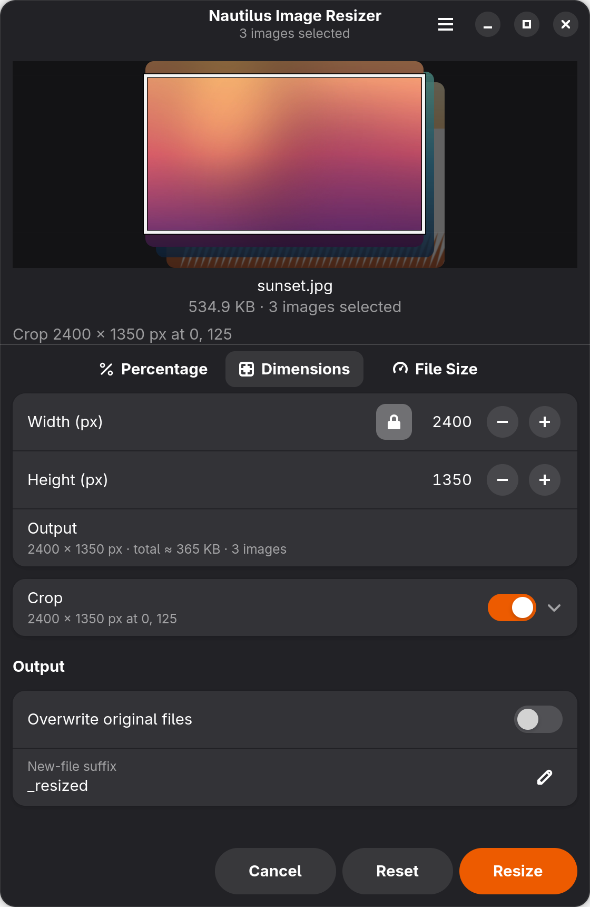

# Nautilus Image Resizer

Right-click an image in GNOME Files (Nautilus), choose **Resize Image**, and pick a size or crop. That is the whole app.



This is a Nautilus plugin plus a small GTK4 / libadwaita app. It is not a GNOME Shell extension, and it is not distributed through extensions.gnome.org.

## What it does

- Adds a `Resize Image…` entry to the right-click menu for image files in Files.
- Opens a window with a preview that grows with it and a live output estimate
  (pixels, percent, and KB / MB) for whichever mode is on screen; with several
  files selected it estimates them in parallel (up to 8 at a time) and shows
  the total.
- Select several images and the menu reads **Resize N Images…**; the preview
  stacks them, first image on top and the rest peeking out behind.
- Resize modes: percent, exact dimensions (with a crop-aware aspect lock), and
  target file size, which drops quality and then resolution until the file fits.
- Crop: a collapsed **Crop** section you arm with its switch, then drag on the
  preview. Presets are Free (dashed), Original, 1:1, 5:4, 4:3, 3:2, 16:10,
  16:9, 21:9 and 19:6 — each drawn as its own rectangle and flippable with
  **Portrait**. The dimension fields follow the crop rectangle.
- **Reset** puts every control back to its default.
- Output: overwrite the original, or save a copy with a suffix (default `_resized`).
- The window closes when the resize is done; the results are in Files.
- Header menu → **About** shows the version, repository, credits and the
  licenses of the libraries it builds on.
- Formats: JPEG, PNG, WEBP, BMP, TIFF. Animated and multi-frame images are refused.
- Engine: Pillow, with EXIF orientation handling so the output is never rotated twice.

## Requirements

- GNOME Files (Nautilus) 43 or later. Tested on Nautilus 51.1.
- `nautilus-python` 4.x (Fedora: `nautilus-python`, Debian/Ubuntu: `python3-nautilus`).
- Python 3, `python3-pillow`, `python3-gobject`, GTK 4, libadwaita.
- The plugin is loaded by Nautilus, so restart Files after install (`nautilus -q`).

Fedora:

```sh
sudo dnf install nautilus-python python3-pillow python3-gobject gtk4 libadwaita
```

Debian / Ubuntu:

```sh
sudo apt install python3-nautilus python3-pil python3-gi gir1.2-gtk-4.0 gir1.2-adw-1
```

## Install

### Fedora, with dnf (COPR)

```sh
sudo dnf copr enable yzraeu/nautilus-image-resizer
sudo dnf install nautilus-image-resizer
nautilus -q
```

### From a checkout

```sh
make install
nautilus -q
```

That installs for your user only:

- App: `~/.local/share/nautilus-image-resizer/image_resizer.py`
- Plugin: `~/.local/share/nautilus-python/extensions/image_resizer_extension.py`
- Desktop file: `~/.local/share/applications/dev.izzy.image-resizer.desktop`
- App metadata: `~/.local/share/metainfo/dev.izzy.image-resizer.metainfo.xml`

Uninstall:

```sh
make uninstall
nautilus -q
```

## Use

1. In Files, right-click one or more images.
2. Choose **Resize Image…**
3. Pick Percent, Dimensions, or File Size. The **Output** line under the
   current mode updates as you change it.
4. To cut the image first, expand **Crop**, flip its switch on, pick a ratio
   (or leave it on Free) and drag on the preview — or focus the preview and use
   the arrow keys (Shift+arrow resizes the region). **Portrait** swaps the ratio;
   the dimension fields and the **Output** estimate follow.
5. Choose overwrite or a suffix, then hit **Resize**. The window closes and the
   results are in Files; if any file failed, the window stays open and says
   which ones and why.

The app can also be run directly, for testing:

```sh
python3 ~/.local/share/nautilus-image-resizer/image_resizer.py photo.jpg
```

Current version: 1.0.0 — the same number the **About** dialog reports.

## Layout

```text
nautilus-image-resizer/image_resizer.py   # GTK app (dialog, preview, crop UI)
nautilus-image-resizer/resize_engine.py   # Pillow engine: decode, crop, size, encode
nautilus/image_resizer_extension.py       # Nautilus MenuProvider, launches the app
data/dev.izzy.image-resizer.desktop.in    # desktop file template
data/dev.izzy.image-resizer.metainfo.xml  # AppStream metadata
tests/test_engine.py                      # headless engine tests, no GUI needed
Makefile                                  # install / uninstall / test
nautilus-image-resizer.spec               # Fedora RPM packaging
```

The plugin launches the app with the selected paths. It looks for the app in
`/usr/share/nautilus-image-resizer/`, then `/usr/local/share/nautilus-image-resizer/`,
then `~/.local/share/nautilus-image-resizer/`, first match wins. So a system
package and a user install both work.

## Fedora packaging

`nautilus-image-resizer.spec` builds the RPM. It needs a `v1.0.0` tag on
GitHub, because `Source0` is the release tarball for that tag.

Build it locally, in a Fedora container (no sudo needed on the host):

```sh
podman run --rm -v "$PWD:/work:z" fedora:45 bash -c '
  dnf -y install rpm-build rpmdevtools make desktop-file-utils libappstream-glib python3-pillow
  spectool -g -R /work/nautilus-image-resizer.spec
  rpmbuild -ba /work/nautilus-image-resizer.spec'
```

Or submit the built source RPM to COPR, which builds it on Fedora infra and
hosts a repo that dnf can use. See the COPR docs for `copr-cli create` and
`copr-cli build`.

## Development

```sh
make test
```

That byte-compiles all three Python files and runs the engine tests in `tests/`,
covering sizing, crop geometry and aspect presets, EXIF handling, the
estimate/write parity (byte for byte, in every mode), the byte-target ladder,
the job failure contract, and the parallel estimate fan-out (input order,
per-file failures, abort). The engine (`resize_engine.py`) imports no GTK, so
the tests run headless with Pillow only; `image_resizer.py` is the GUI and
imports the engine.

## License

GPL-3.0-or-later. See `LICENSE`.
